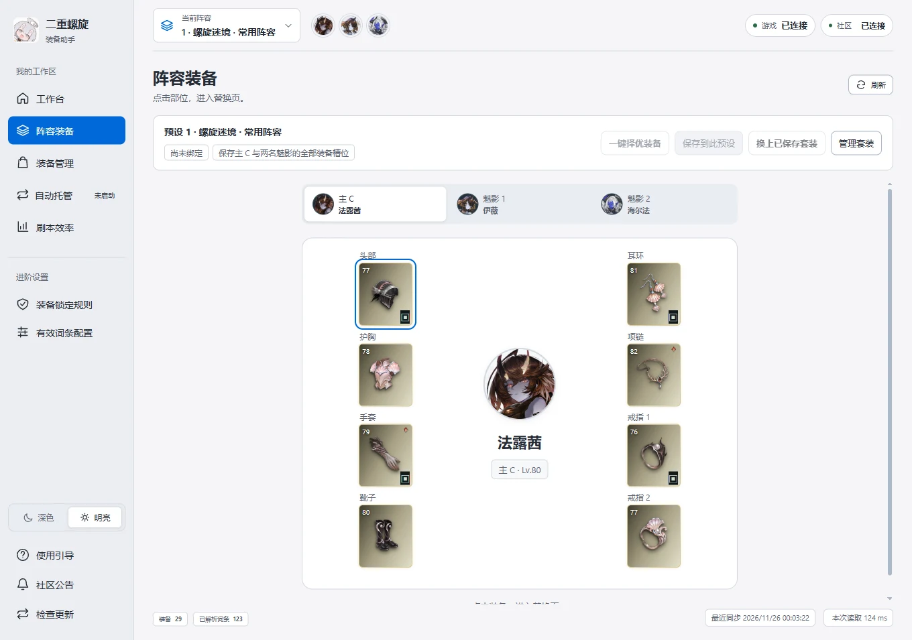
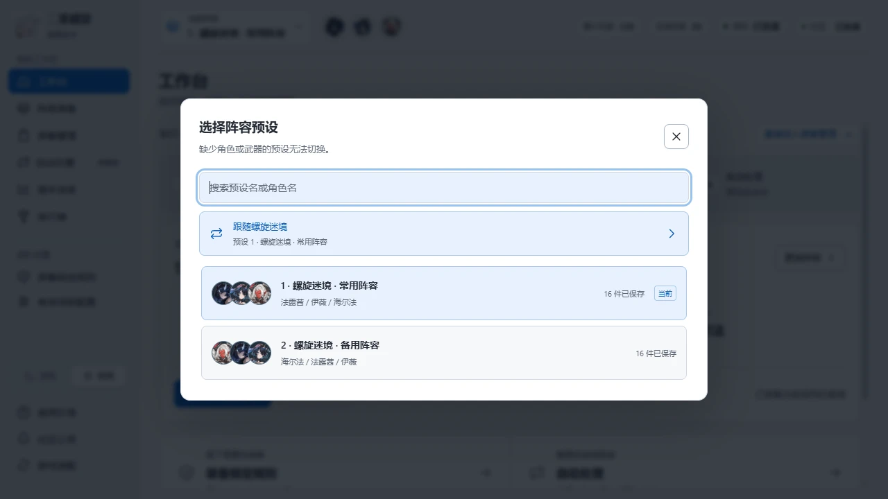
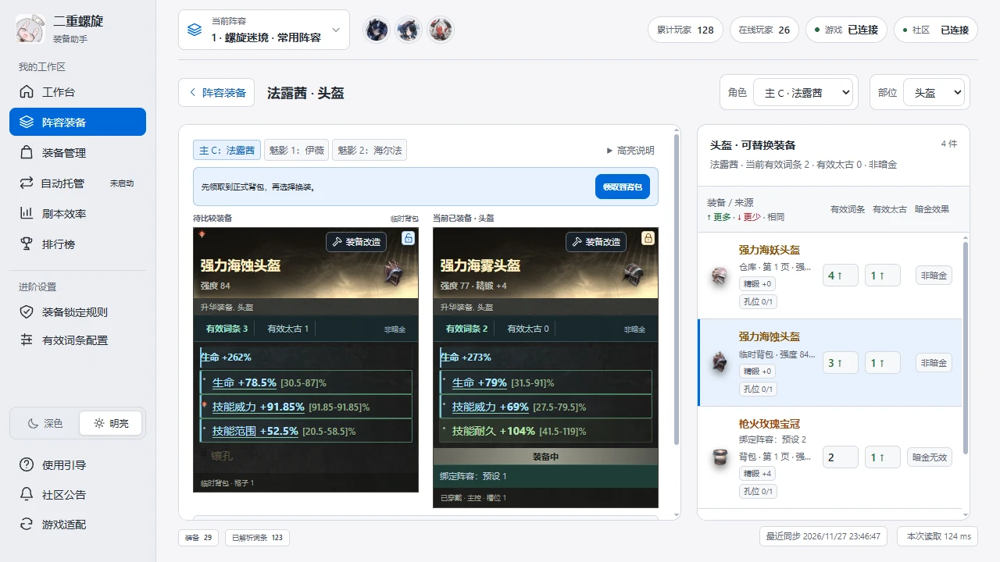
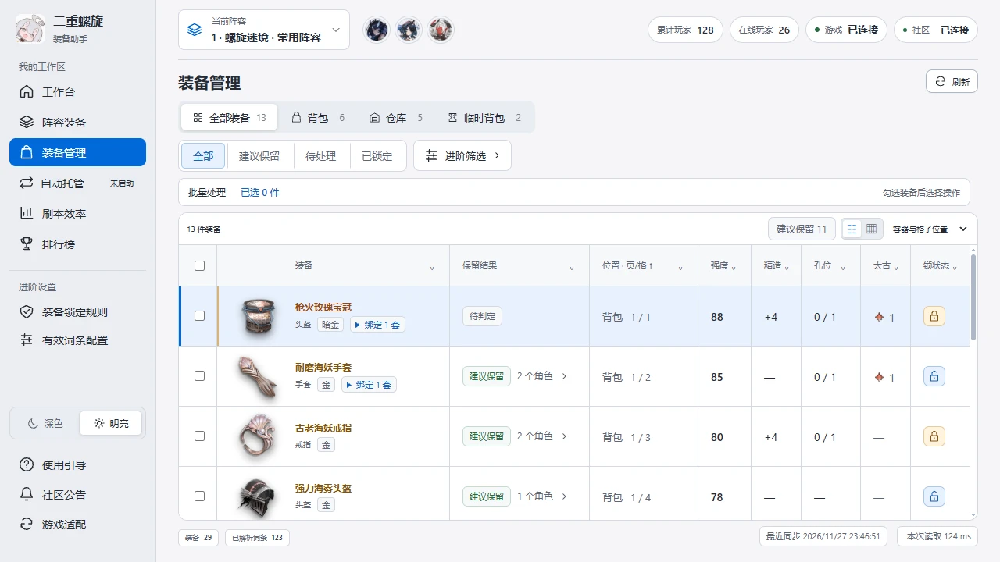
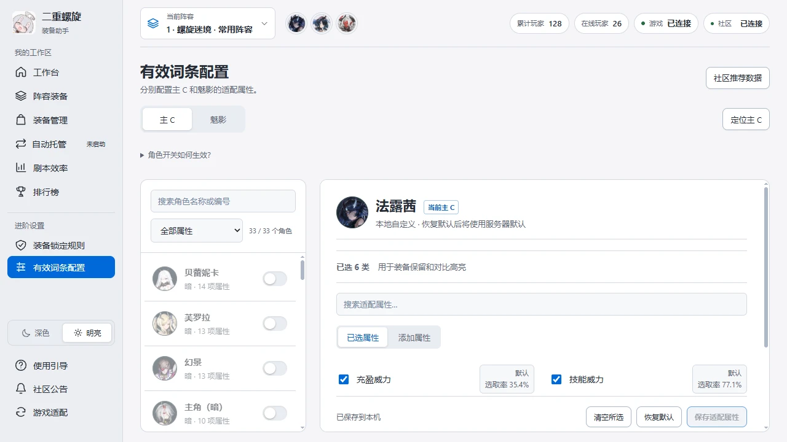
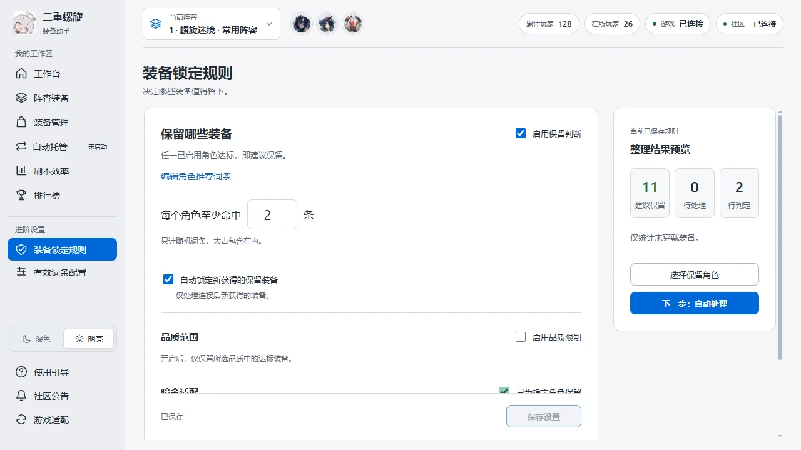
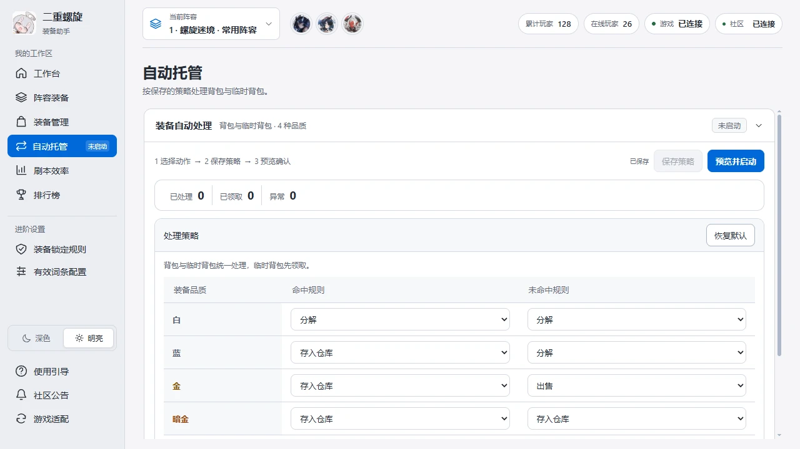
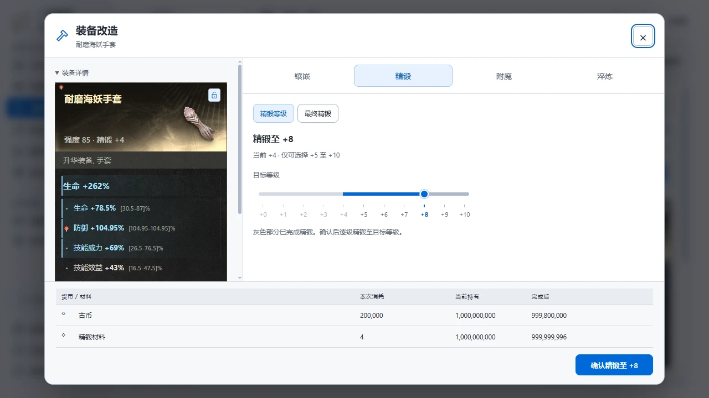
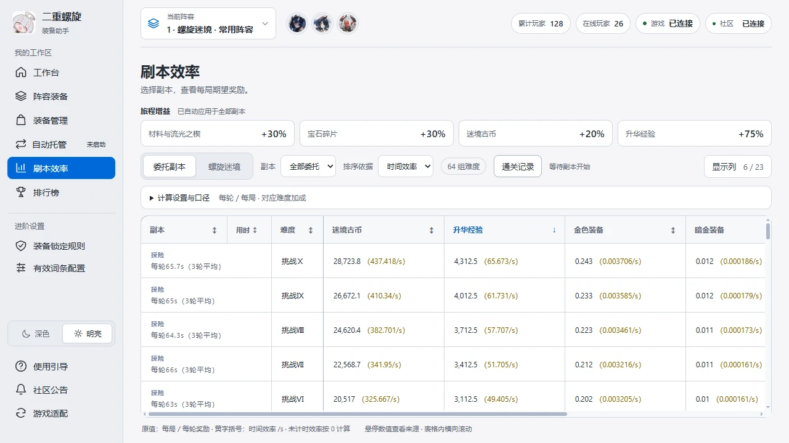
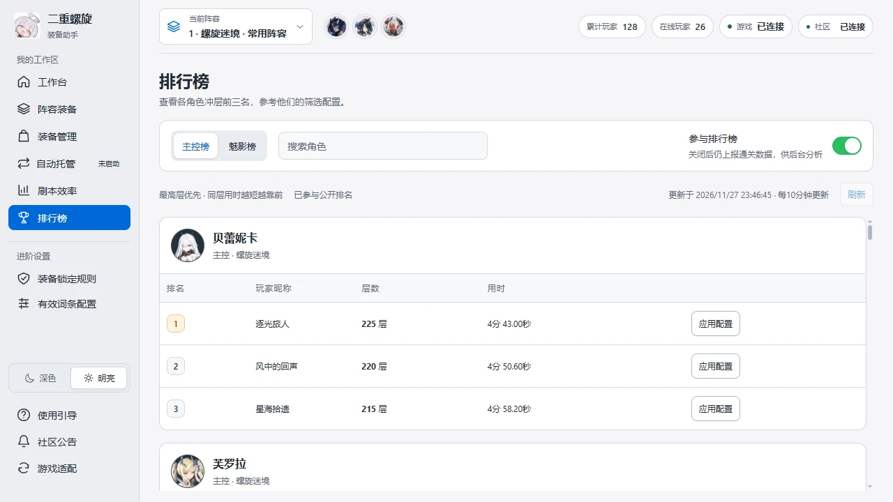

# 二重螺旋 · 装备助手

**DNA Equip Manager** 是面向《二重螺旋》玩家的 Windows 装备管理工具。选好阵容、配好装备，再按自己的规则锁定和整理掉落。

[项目官网](https://equip-manager.eclx.win/) · [官网排行榜](https://equip-manager.eclx.win/rank) · [问题反馈](https://github.com/awesomehy/DNAEquipManager/issues) · [使用讨论](https://github.com/awesomehy/DNAEquipManager/discussions) · [GitHub](https://github.com/awesomehy/DNAEquipManager) · [Gitee](https://gitee.com/awesomehy/DNAEquipManager)

## 从这里开始

1. **选阵容**：在顶部选择自己的完整阵容预设，确认主 C 和两名魅影。
2. **配装备**：一键择优并预览换装结果，或点击装备部位，逐件比较后替换。
3. **设规则**：分别调整主 C、魅影的有效词条和暗金适配角色，设置装备锁定条件。
4. **做整理**：先预览自动托管的处理计划，再启动；也可到装备管理页手动筛选、批量处理。

已有多套配装时，可以把当前整套装备绑定到阵容预设，之后切换预设时一起换装。同一件装备可以用于多套预设。

## 功能一览

| 功能 | 可以做什么 |
| --- | --- |
| **阵容预设与整套换装** | 保存主 C、两名魅影的装备配置；切换前确认是否保存当前修改、是否一起换装。绑定装备自动锁定，换下的装备默认入仓。 |
| **一键择优与装备比较** | 按正在比较角色的本地配置，综合有效词条、有效太古和暗金适配情况排序；并排比较同部位装备，戒指可切换槽位，附魔和淬炼词条也参与择优。 |
| **背包、仓库、临时背包** | 集中查看未穿戴装备，按品质、部位、锁定状态和保留结果筛选；支持整格勾选、批量锁定／解锁、存取、出售和分解。临时背包只取不存。 |
| **有效词条与锁定规则** | 主 C、魅影分别设置推荐词条和启用角色；可恢复社区默认，或按选取率一键应用推荐。支持品质要求、指定暗金适配角色，并自动锁定新获得的达标装备。 |
| **自动托管** | 背包与临时背包共用策略；按白、蓝、金、暗金品质及是否命中规则，设置不处理、出售、分解或存仓。存仓从前到后找空位，启动前可预览。 |
| **装备改造** | 在装备预览中打开改造窗口，进行镶嵌、宝石购买／拆取、精锻与最终精锻、附魔、淬炼；查看材料消耗、当前持有量和操作结果。 |
| **刷本效率** | 查看四类委托各 16 个难度与螺旋迷境 1～250 层的奖励期望；结合难度、旅程增益及自动记录的通关均时，比较每局／每轮收益和每秒效率。 |
| **角色排行榜** | 主控、魅影分别查看各角色冲层前三名，按层数及同层用时排序，每 10 分钟刷新；预览并应用上榜玩家对应角色的词条及暗金配置。 |
| **游戏适配与账号存档** | 从服务器加载、热切换适配数据；受控兼容仍需本机逐功能核验。阵容绑定、通关记录、有效词条、锁定规则及托管策略按游戏 UID 分开保存。 |

## 界面预览

点击展开对应界面。截图均为 1280 × 720，角色头像已修正颜色。

<strong>阵容预设：查看角色组合和已绑定的装备</strong>

为不同玩法保存不同配装；内容不完整的预设会提示原因，避免选错阵容。

<strong>装备比较：当前穿戴与候选并排看</strong>

候选来自背包、仓库和临时背包。分别显示有效词条、有效太古、暗金是否有效，以及精锻和孔位信息；不展示内部排序分值。

<strong>装备管理：筛选、勾选和批量处理</strong>

列表集中展示装备及保留结果，低频筛选折叠收起。鼠标停留在装备名称或图标区域 0.5 秒，可查看单件装备预览。

<strong>有效词条配置：主 C 与魅影各用一套</strong>

每个角色可以单独开启或关闭主 C／魅影推荐，也可以按社区选取率应用配置。暗金适配名单可单独调整。

<strong>装备锁定规则：决定哪些新装备值得保留</strong>

按本地有效词条设置保留门槛，并结合品质、指定暗金适配角色判断。已有装备可在装备管理中筛选后手动批量处理。

<strong>自动托管：按品质和命中结果配置策略</strong>

背包、临时背包统一处理，仓库只作为存入目标。先预览，再启动；结果无法确认时暂停，避免重复处理。

<strong>装备改造：选目标等级，先看材料再确认</strong>

镶嵌、精锻、附魔、淬炼集中在一个窗口；精锻支持选择目标等级，最终精锻可查看命中词条的数值变化。

<strong>刷本效率：保留单局收益，同时比较每秒效率</strong>

自动记录成功通关或完成整轮的用时；有记录的副本在原始收益后显示时间效率。奖励列可开关，数据可按数量或效率排序，通关记录支持单项删除和全部重置。

<strong>排行榜：看角色成绩，也参考装备思路</strong>

主控、魅影分榜，公开展示昵称、层数和用时，不显示 UID。应用配置只影响所选角色；也可关闭公开参榜，通关数据仍用于后台统计。

## 使用说明

- **静默读取**：不依赖界面截图或 OCR；手动操作先预览确认，自动处理按玩家启用的托管策略执行。
- **多账号分开保存**：确认当前游戏 UID 后加载对应存档；切号时停止旧账号托管，不混用装备配置和通关记录。
- **社区推荐可修改**：默认数据用于起步，玩家可以保留自己的有效词条和暗金适配方案。
- **明亮／深色主题**：默认深色，可在侧栏切换。装备比较页按 `Esc` 返回。

## 反馈与版权

遇到问题请到 [Issues](https://github.com/awesomehy/DNAEquipManager/issues) 描述复现步骤、工具和游戏版本；使用心得、建议和配装交流欢迎到 [讨论区](https://github.com/awesomehy/DNAEquipManager/discussions)。附图前请遮挡个人信息。

软件作者：[@awesomehy](https://github.com/awesomehy)。使用和转载条款见 [LICENSE](LICENSE)。《二重螺旋》角色、装备及游戏美术归各自权利人所有。
